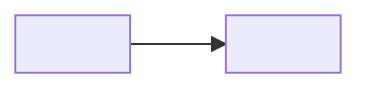

# Architektura

<!-- AI: Źródła: kod repozytorium, /.vibe/01-prd.md (sekcje 4 i 8), /.vibe/07-domain-model.md. Wpisuj tylko to, co wynika ze źródeł; reszta to TODO. -->

## Przegląd
<!-- AI: Odpowiedzialności serwisu i jego rola w domenie. -->
(TODO)

## Powiązania z innymi systemami
<!-- AI: Diagram Mermaid: aplikacja w centrum, kto z nią rozmawia i w którą stronę (użytkownicy, serwisy, systemy zewnętrzne), z protokołem. Pomiń infrastrukturę techniczną. Relacja czyta się jak zdanie. -->

## Komponenty
<!-- AI: Diagram komponentów tylko dla aplikacji złożonej: główne części (moduły, warstwy), ich odpowiedzialność i zależności. Bez klas. Pod diagramem tabela: gdzie w kodzie szukać. -->

| Komponent | Odpowiedzialność | Gdzie w kodzie |
|-----------|------------------|----------------|
| (TODO)    |                  |                |

## Kontekst domenowy
<!-- AI: Domena, granice kontekstu, właściciel; odniesienie do /.vibe/07-domain-model.md. -->
(TODO)

## Zagadnienia przekrojowe
<!-- AI: Logowanie, walidacja, autoryzacja, health checki, metryki — podejście i miejsce w kodzie. -->

| Obszar | Podejście | Gdzie |
|--------|-----------|-------|
| (TODO) |           |       |

## Stos i wdrożenie
<!-- AI: Języki, frameworki, bazy, brokery z plików zależności; środowiska, pipeline i hosting z plików wdrożeniowych i CI. -->
(TODO)

## Decyzje
Zobacz [adr.md](adr.md).
